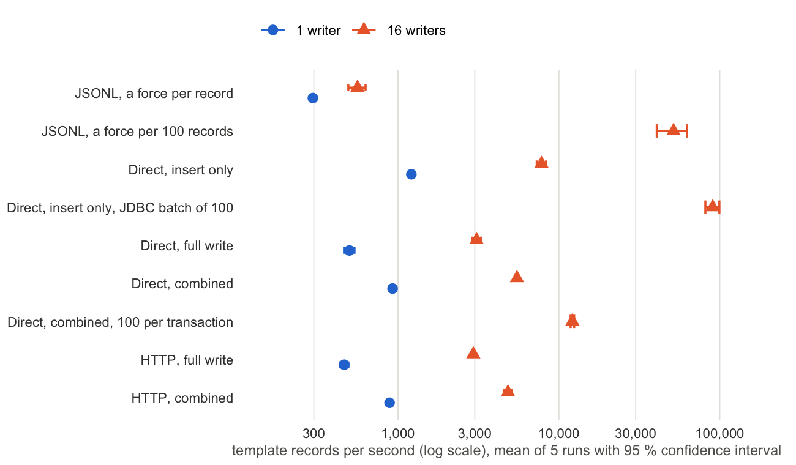

# Storing provenance bindings: options and their cost

*Draft, 31 October 2026.*

The previous sections showed how an application records provenance as bindings for a template, from code generated
for the template, through a logger or a builder, as JSON or CSV. What remains open is where those bindings go. A
provenance template management system has to store them, and ProvToolbox offers the developer three ways to do so,
which differ in what they give and in what they cost:

- **The template service (HTTP).** The application posts its bindings to `provapi/statements` on a template service
  generated by `prov-template-archetype`. The service checks them against the template, stores the record and
  answers with its identifier. This is the complete system: records with identifiers, a cryptographic hash, access
  control, idempotent submission, the PROV relations that navigation and explanation rely on, and clients in any
  language.
- **Direct writes from the application (direct).** The same code runs inside the application's own JVM: the generated
  catalogue composes the same SQL as the service, and runs it on the application's own database connections. No
  service is deployed, and the application controls its transactions, but it takes on what the service would
  otherwise do (access control in particular), and it is tied to Java and to the generated classes.
- **Capture to files (JSONL).** Each record's bindings are serialised as one JSON line and appended to a local file,
  which is forced to disk after each record or batch of records. Nothing is indexed, related or queryable until the
  files are loaded into a store: this is a capture format, not a store.

Within the store, the developer also chooses how much work each record involves. A **full write** is what the service
does by default: the template's insert function allocates the record's entities and activities and inserts the
record and its index entry; the record is read back under access control, hashed, and its hash written to the index;
its PROV relations are inserted into the relation tables; and an idempotency key guards against a resent submission.
A **combined** write switches off the access-controlled read-back, the hash and the idempotency key, and writes the
relations asynchronously, shortly after the record's commit. **Insert only**, available to direct writes, keeps the
first step alone. All three write the same records, with fewer guarantees from full to insert only.

## How they were measured

The three options were measured on one machine (Table 1), writing the same workload: records of the file-system
template family, from a mix of its eight templates in fixed proportions, one message in twelve being a composite of
three elements. Values were unique, and records referred to entities created by earlier records, so that they formed
a connected provenance graph. Each run started on an empty store, warmed up, then counted the records written during
a measured window: 30 s for HTTP (after 10 s of warm-up), 20 s for direct writes (after 5 s), 10 s for JSONL (after
3 s). Every run checked that the store held exactly the records the harness had written. Each configuration was run
five times, the configurations taken in turn on each pass so that any drift of the machine spread over all of them.
The figures below are the means of the five runs with 95 % confidence intervals, mean ± 2.776 s/√5, where s is the
standard deviation of the five runs and 2.776 is Student's t for four degrees of freedom.

Table 1. The machine and software.

| | |
|---|---|
| Computer | Apple MacBook Pro (Mac16,6), macOS 26.5.2 |
| Processor | Apple M4 Max, 16 cores (12 performance, 4 efficiency) |
| Memory | 48 GB |
| Storage | 2 TB internal SSD (Apple SSD AP2048Z), APFS |
| Database | PostgreSQL 16.15 (aarch64) in Docker Desktop 29.7.2, a Linux virtual machine with 16 virtual CPUs and 7.65 GiB of memory; data on a Docker volume, `shared_buffers` 1.25 GB; `fdatasync` of an 8 kB write in 92 µs (10,919 per second) |
| Java | Temurin 19.0.1; the service's JVM with a 2 GB heap (G1) |
| Software | ProvToolbox 2.3.0-SNAPSHOT, provenance-templates-library 0.1.0-SNAPSHOT |

Client, service and database shared the one machine. Writing a record per transaction, the database used at most
2.7 of its 16 virtual CPUs and the service's JVM at most one core, so that neither was saturated; only the batched
inserts drove the database to about 10 virtual CPUs.

## Results

Table 2. Template records written per second, mean of five runs [95 % confidence interval]; p99 latency of a write
(an HTTP message, a direct transaction, or a JSONL batch); database CPU time per record. The file-system family;
B is the number of records per transaction (direct) or per forced write (JSONL).

| Option | Writers | B | Records per second [95 % CI] | p99 latency (ms) | Database CPU per record (ms) |
|---|---:|---:|---:|---:|---:|
| JSONL, a force per record | 1 | 1 | 296 [286, 306] | 6.5 | — |
| JSONL, a force per record | 16 | 1 | 560 [492, 629] | 104.7 | — |
| JSONL, a force per 100 records | 16 | 100 | 51,581 [40,579, 62,582] | 113.2 | — |
| Direct, insert only | 1 | 1 | 1,211 [1,159, 1,262] | 2.1 | 0.18 |
| Direct, insert only | 16 | 1 | 7,799 [7,282, 8,315] | 5.0 | 0.28 |
| Direct, insert only, JDBC batch | 16 | 100 | 90,360 [81,345, 99,375] | 64.3 | 0.11 |
| Direct, full write | 1 | 1 | 499 [462, 536] | 7.5 | 0.51 |
| Direct, full write | 16 | 1 | 3,081 [2,884, 3,278] | 18.4 | 0.77 |
| Direct, combined | 1 | 1 | 925 [877, 974] | 3.4 | 0.42 |
| Direct, combined | 16 | 1 | 5,490 [5,394, 5,586] | 8.8 | 0.49 |
| Direct, combined | 16 | 100 | 12,137 [11,831, 12,442] | 693.5 | 0.36 |
| HTTP, full write | 1 | 1 | 463 [435, 491] | 7.8 | 0.53 |
| HTTP, full write | 16 | 1 | 2,939 [2,878, 3,000] | 18.4 | 0.80 |
| HTTP, combined | 1 | 1 | 886 [880, 893] | 3.4 | 0.45 |
| HTTP, combined | 16 | 1 | 4,825 [4,543, 5,107] | 10.3 | 0.56 |

Figure 1. Template records per second for each option, on a logarithmic scale; mean of five runs with its 95 %
confidence interval, which is often narrower than the marker. Configurations writing 100 records per transaction or
per forced write were measured with 16 writers only.

Five observations stand out.

**The service costs little.** Doing the same work with the same number of writers, the service reached 93 % of the
direct rate for a full write with one writer and 95 % with sixteen, and the confidence intervals overlap; the same
holds for a combined write with one writer (96 %). Only for combined writes with sixteen writers is the difference
clear: 4,825 against 5,490 records per second, 88 %. The database spends the same time on a record either way, and the
service's own work (0.2–0.5 ms of CPU per record) runs on processor cores the database does not use. HTTP, JSON and
the web container are not what limits the system.

**The work per record is what costs.** A full write takes 2.4 to 2.5 times as long as an insert alone, with one writer
as with sixteen (499 against 1,211, and 3,081 against 7,799 records per second). A combined write recovers most of the
difference: 1.8 to 1.9 times the rate of a full write with one writer, 1.6 to 1.8 times with sixteen. Of the parts it
switches off, writing the relations after the commit rather than inside it contributes most.

**Concurrency scales every database option.** From one writer to sixteen, full writes went from 463 to 2,939 records
per second through the service (6.3 times) and from 499 to 3,081 directly (6.2 times); inserts alone, 6.4 times.
Each record is its own transaction of several statements, and a single writer leaves the database waiting for the
next statement of the record between round trips; writers in parallel fill those waits.

**Grouping records is the largest lever.** One hundred records per transaction raised combined direct writes from
5,490 to 12,137 records per second (2.2 times), at the price of transactions taking up to 0.7 s (p99). Inserts sent as a JDBC batch of
100 reached 90,360 records per second, nearly twelve times the rate of one insert per transaction: the database then
spends its time inserting rather than committing.

**A file is not necessarily faster.** Forcing each JSON line to disk gave only 296 records per second, and 560 with
sixteen writers. On macOS, Java's `force` asks the drive to flush its own cache (`F_FULLFSYNC`), which took about
4 ms on this machine, against 22 µs for an ordinary `fsync`; the database in its virtual machine flushes in 92 µs and
does not reach the drive's cache. The two are therefore not equally durable here: a forced JSON line on a Mac is more
durable than a committed record in this database. Forced once per 100 records, the files took 51,581 records per
second, with a wide interval, as is usual for an SSD's flushes.

## Choosing

For most applications the template service is the right default: it is as fast as writing from the application's
own process, and it brings everything a provenance template management system needs. It should be given a pool of
database connections at least as large as the number of concurrent clients, and its relations written asynchronously
where readers can wait a few milliseconds for them: on this machine, about 3,000 records per second with every
guarantee, and nearly 5,000 with the combined write. Writing directly from the application pays when the
application controls bulk loads: then grouping records into transactions, or inserting them as batches, multiplies
the rate, from 12,000 to 90,000 records per second here. Capture to JSONL files suits an application that must
record provenance where no store is reachable, or faster than one can take it, provided the files are forced in
batches and loaded later; until then its records cannot be queried.

These figures come from one laptop, with the database in a virtual machine and each run starting on an empty store.
They show the relative cost of the options, not the limits of a production deployment, where larger stores, other
disks and a network between client and server would move the absolute numbers.
